# Class Diagram — Hollow Chains Demo (v0.1, แผนก่อนเขียนโค้ด)

> เจ้าของ: ธีร์ · ตรวจ: กานต์, ณิชา · อ้างอิง: `TECH_SPEC.md` §4, skill `unity-csharp-architecture` (OOP/SOLID — D-020)
> สถานะ: **แผน + โค้ดบางส่วน** (หัวข้อที่มี ✅ = ตรงกับโค้ดจริง); ชื่อคลาสอาจปรับตอนลงมือ และต้องอัปเดตไฟล์นี้ใน commit เดียวกับโค้ดทุกครั้ง
> ดูภาพ: เปิดไฟล์นี้บน GitHub (branch `phase/P1-preproduction`) — GitHub วาด Mermaid ให้อัตโนมัติ

## วิธีอ่าน
| สัญลักษณ์ | ความหมาย | หลัก OOP |
|---|---|---|
| `<<interface>>` | สัญญา (สิ่งที่ทำได้) ไม่มีโค้ดจริง | Abstraction |
| `<<abstract>>` | คลาสแม่ที่มีโค้ดร่วม ใช้ตรง ๆ ไม่ได้ | Inheritance |
| `A <\|-- B` | B สืบทอดจาก A | Inheritance |
| `A <\|.. B` | B ทำตาม interface A | Polymorphism |
| `A *-- B` | A เป็นเจ้าของ B (B ตายตาม A) | Composition |
| `A o-- B` | A ใช้ B ที่มีอยู่แล้ว | Aggregation |
| `A ..> B` | A เรียกใช้ B | Dependency |
| `-` / `+` | private / public | Encapsulation |

หลักที่ทีมยึด: **Composition ก่อน, Inheritance ตื้น ๆ เฉพาะ "is-a" จริง**, สื่อสารข้ามระบบผ่าน Event Channel (ไม่อ้างอิงกันตรง ๆ), พึ่ง interface ไม่ใช่คลาสจริง

---

## 1. Core — รากฐาน (`HollowChains.Core`) ✅ มีโค้ดแล้ว (P2.0)
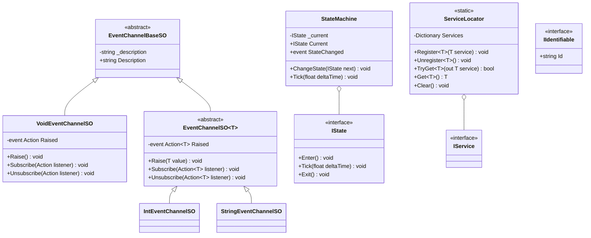

## 2. Data — ข้อมูลเกม (`HollowChains.Data`, ScriptableObject)
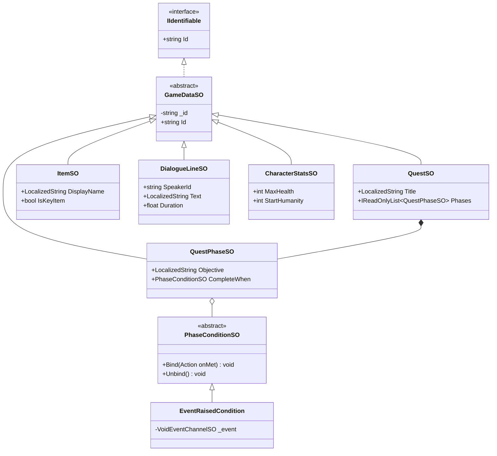

## 3. Gameplay — ผู้เล่น / Interact / ค่าสถานะ (`HollowChains.Gameplay`) — ✅ Player ส่วนเคลื่อนที่มีโค้ดแล้ว (P2.1); Interact/Health = แผน
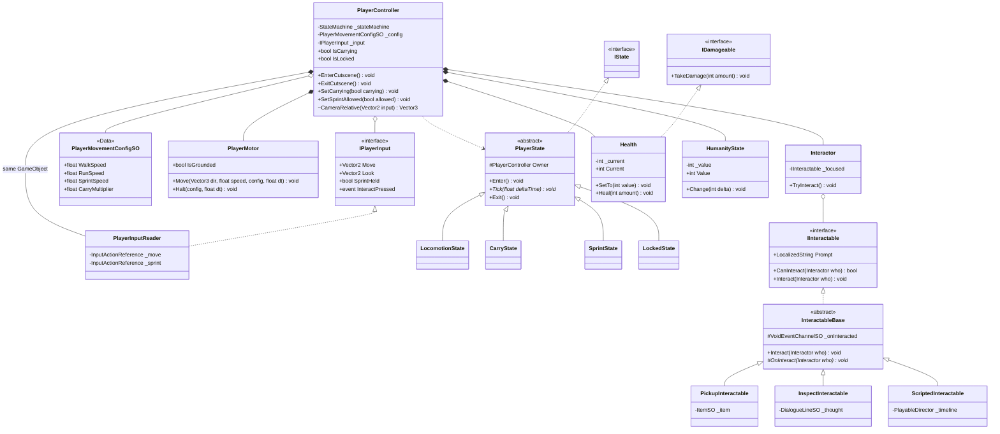
`ScriptedInteractable` = prompt "วิ่งเข้าไปกอด" (SC-04) และ "ยื่นมือ" (SC-06) · `HumanityState` ไม่มี UI (D-002)

## 4. Quest / Save / Scene flow (`HollowChains.Gameplay`)
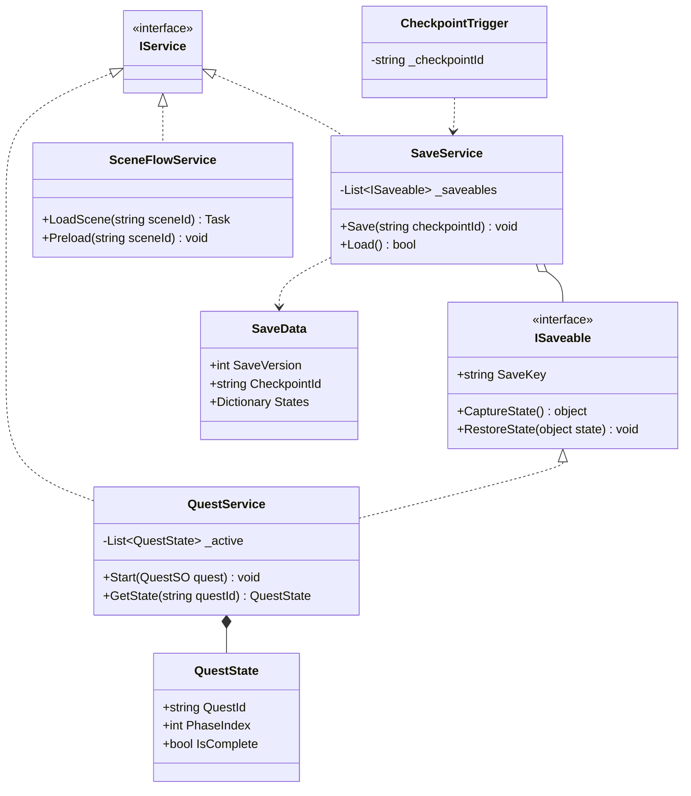

## 5. Narrative — บทพูด / Cutscene / Comic hook (`HollowChains.Narrative`)
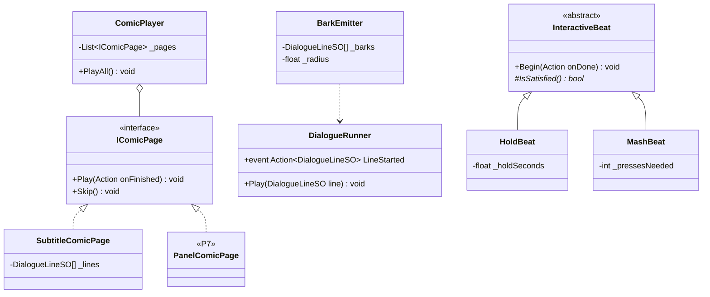
`SubtitleComicPage` = S00 ตอนนี้ · `PanelComicPage` = Comic จริงใน P7 (เสียบแทนโดยไม่แก้ `ComicPlayer` — Open/Closed)
`HoldBeat` = "ปล่อยราก" (SC-05) · ผลลัพธ์คงที่ ล้มเหลวไม่ได้

## 6. UI (`HollowChains.UI`)
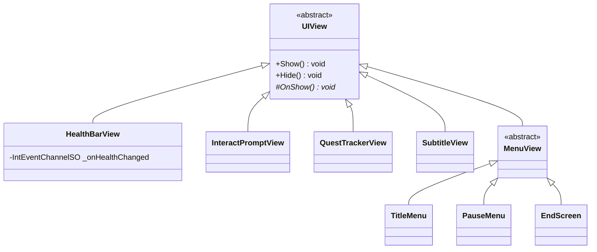
UI ฟัง Event Channel เท่านั้น — ไม่อ้างอิง `PlayerController` / `QuestService` ตรง ๆ (UI กับ Gameplay เปลี่ยนแยกกันได้)

## 6b. ✅ มีโค้ดแล้วใน P2.0b–P2.4 (Flow / Triggers / Camera / Interaction / UI)
> แทนที่ส่วน Interaction ใน §3 และ SceneFlow ใน §4 (ส่วน Health/Quest/Save ใน §3–4 ยังเป็นแผนของ P3)
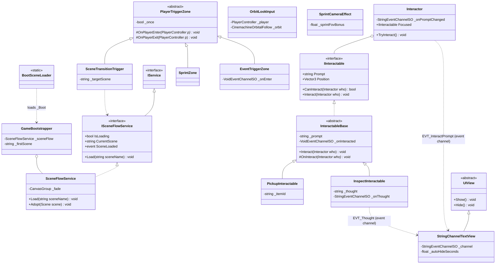
`ScriptedInteractable` (กอด/ยื่นมือ) เลื่อนไป P5 พร้อม Timeline · ข้อความทั้งหมดยังเป็น placeholder อังกฤษ `[PH]` จนกว่าจะมีฟอนต์ไทย + Localization (P3.3)

## 6c. ✅ Quest system (P3.1)
> แทนที่แผน Quest ใน §2/§4 · Objective ยังเป็น string `[PH]` → เปลี่ยนเป็น LocalizedString ใน P3.3
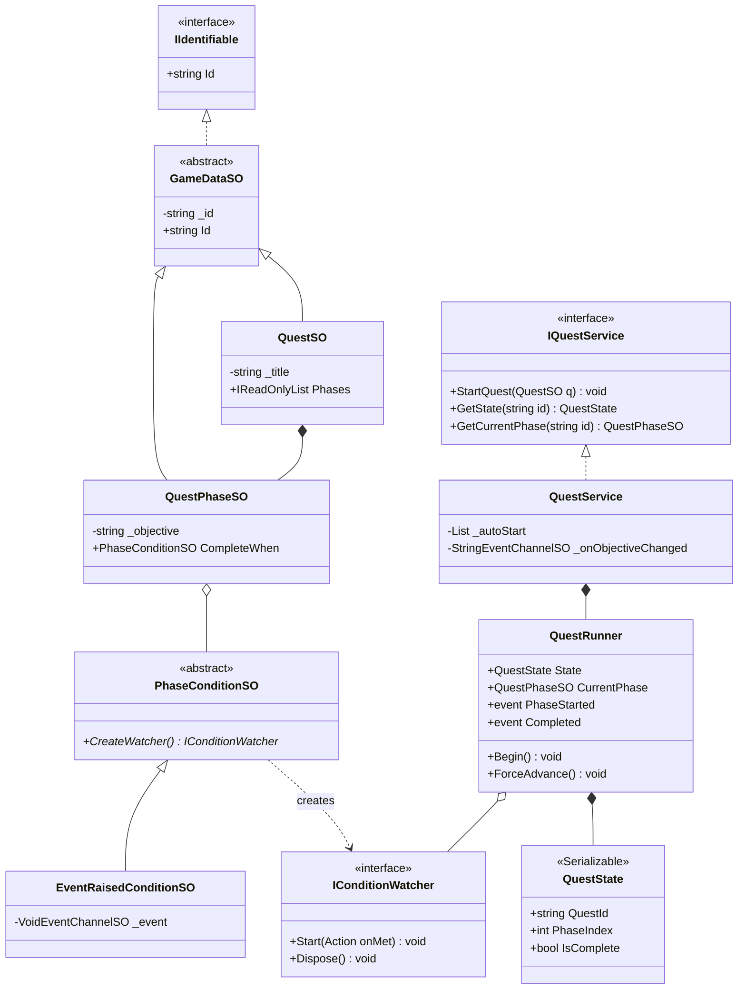
Watcher แยก state การฟัง event ออกจาก SO (SO เป็น asset ที่แชร์กัน ห้ามเก็บ runtime state) · เงื่อนไขชนิดใหม่ = subclass ใหม่ของ `PhaseConditionSO`

## 6d. ✅ Dialogue / Subtitle (P3.2)
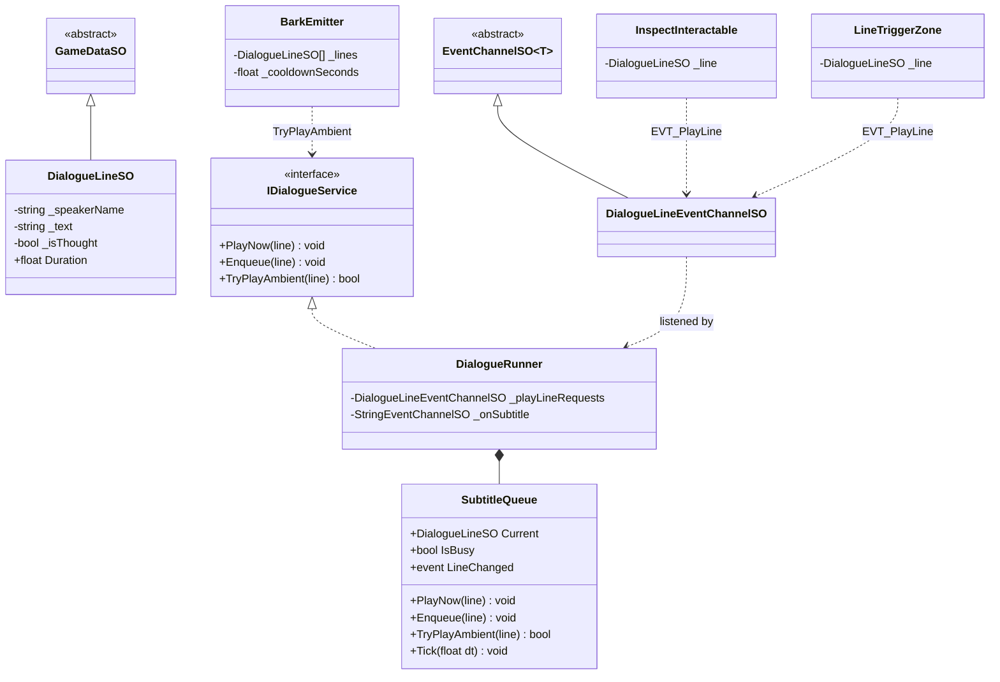
Gameplay ขอเล่นบทผ่าน `EVT_PlayLine` (ไม่อ้างอิง Narrative) · Barks ไม่ขัดบทหลัก (`TryPlayAmbient`) · UI แสดงจาก `EVT_Subtitle`

## 6e. ✅ Localization + ภาษาไทย (P3.3)
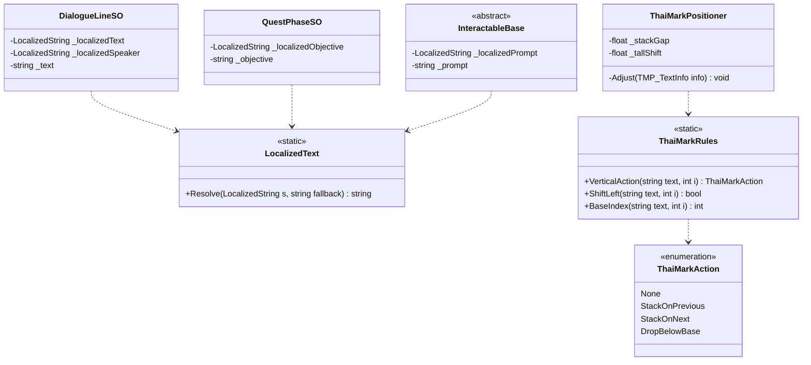
ข้อความมาจาก string table `UI` / `Dialogue` / `Quests` (locale `th` เริ่มต้น) · `ThaiMarkPositioner` ติดกับ TMP ทุกตัวที่แสดงไทย (D-034)

## 6f. ✅ Game flow, เมนู, HP (P3.3b)
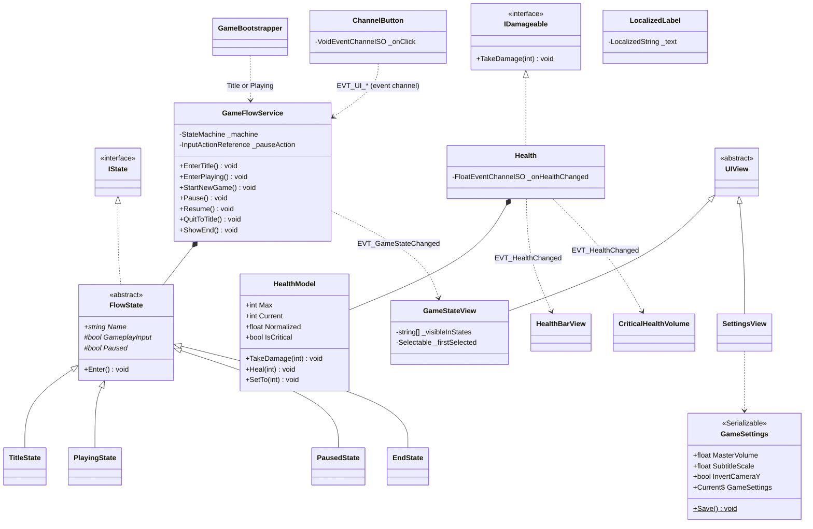
เมนูไม่อ้างอิง gameplay — ปุ่มยิง `EVT_UI_*`, `GameFlowService` ฟังแล้วประกาศ state กลับผ่าน `EVT_GameStateChanged`

## 7. ภาพรวมการพึ่งพา Assembly
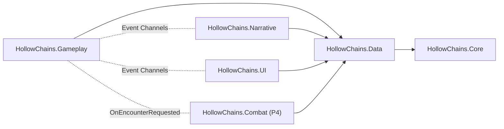
ลูกศรทึบ = อ้างอิงโค้ด · เส้นประ = คุยผ่าน Event Channel (ไม่อ้างอิงกัน)
